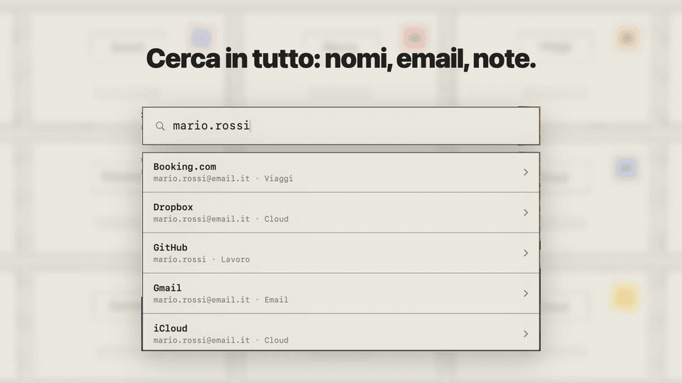

# Hush

Il gestore di password che resta sul tuo Mac. Niente server, niente account:
le tue password stanno in file che possiedi tu, nel formato aperto di KeePass.

[](docs/hush-demo.mp4)

[Guarda il video con l'audio](docs/hush-demo.mp4)

## Scarica

### ⬇️ [Scarica Hush per Mac](https://github.com/AntonioScirica/hush/releases/latest/download/Hush.dmg)

1. Apri il file `Hush.dmg` appena scaricato.
2. Trascina l'icona di Hush nella cartella **Applicazioni**.
3. Apri Hush da Applicazioni (o da Spotlight) e scegli la tua password principale.

Serve macOS 14 (Sonoma) o successivo. L'app è firmata e verificata da Apple, si
apre senza avvisi e si aggiorna da sola quando esce una nuova versione.

## Cosa fa

- **Tutto in locale**: le password sono cifrate sul tuo Mac (AES-256 e
  Argon2id). Nessuno, nemmeno chi ha scritto l'app, può leggerle.
- **Formato aperto**: i tuoi "cassetti" sono file KeePass standard. Se un
  giorno vuoi cambiare app, te li porti dietro.
- **Touch ID** per sbloccare, con la password principale come riserva.
- **Scorciatoie da qualsiasi app**: `⌘P` cerca una voce e ne copia password,
  utente o qualsiasi altro campo; `⌃⌘P` aggiunge una voce al volo. Si
  cambiano nelle Impostazioni.
- **Riempimento automatico** su iPhone, su Mac, in Safari (inclusa nell'app) e
  in Chrome con l'[estensione dal Chrome Web Store](https://chromewebstore.google.com/detail/hush/pfifohnafgmhkdfeahhpojbbehoigean).

Gratis, senza prova a tempo né licenze.

---

## Per sviluppatori

Il codice è sotto licenza [MIT](LICENSE): puoi studiarlo, modificarlo e
compilarlo da te.

Servono Xcode 16+ e [XcodeGen](https://github.com/yonaskolb/XcodeGen):

```bash
cd VaultCore && swift test && cd ..   # verifica la parte crittografica
brew install xcodegen
xcodegen generate
open Hush.xcodeproj
```

`project.yml` usa il team Apple Developer e gli identificativi dell'autore. Per
compilare con il tuo account sostituisci `DEVELOPMENT_TEAM`, i bundle id
(`com.antonioscirica.*`), l'App Group e il Keychain access group
(`69SHH7M6DY.com.antonioscirica.hush.bridge`, il prefisso deve essere il tuo
Team ID). Guida passo passo in [ISTRUZIONI.md](ISTRUZIONI.md).

| Cartella | Contenuto |
| --- | --- |
| `VaultCore/` | Pacchetto Swift: lettura/scrittura KDBX4, cifratura, testato. |
| `App/` | App macOS e iOS (SwiftUI), codice comune in `App/Shared`. |
| `AutoFillExtension/`, `MacAutoFillExtension/` | Estensioni di riempimento automatico di sistema. |
| `SafariExtension/` | Estensione Safari. |

L'estensione Chrome è in un repository a parte:
[hush-chrome-extension](https://github.com/AntonioScirica/hush-chrome-extension).

## Licenza

[MIT](LICENSE) © 2026 Antonio Scirica
